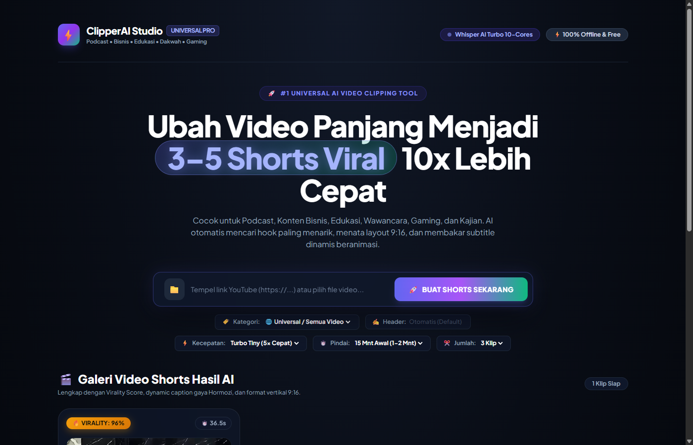

# ⚡ ClipperAI Studio — Universal AI Video Shorts Generator
> **Open-Source Local Alternative untuk Opus Clip, Submagic, & Klap**  
> 100% Offline, Gratis Selamanya, Bebas Biaya Berlangganan & Tanpa Kuota API Bulanan!



[](https://www.python.org/)
[](https://fastapi.tiangolo.com/)
[](https://github.com/SYSTRAN/faster-whisper)
[](https://ffmpeg.org/)
[](LICENSE)

---

## 🌟 Apa itu ClipperAI Studio?
**ClipperAI Studio** adalah aplikasi desktop berbasis AI lokal yang mengubah video panjang (rekaman seminar, podcast, talkshow, edukasi kuliah, konten bisnis, gaming, hingga kajian/dakwah) menjadi **3–5 video vertikal Shorts/Reels viral (9:16)** secara otomatis hanya dalam 1 klik.

Semua proses transkripsi kata-demi-kata (speech-to-text), deteksi hook kalimat viral, penataan aspek rasio vertikal 9:16, pemberian efek suara (SFX whoosh/pop), dan pembakaran *dynamic animated subtitles* dilakukan **100% di komputer lokal Anda** tanpa mengirim data ke cloud atau membayar langganan bulanan mahal.

---

## ✨ Fitur Unggulan

### 1. 🌐 Dukungan Multi-Niche & Kategori Universal
AI secara otomatis menyesuaikan gaya judul hook, header atas, dan hashtag sesuai topik video:
- 🌐 **Universal / Semua Topik**: Vlog, wawancara santai, tips harian, dan dokumenter.
- 🎙️ **Podcast & Talkshow**: Fokus pada pertanyaan tajam, jawaban mengejutkan, dan interaksi seru.
- 💡 **Bisnis, Finansial & Tech**: Mengutamakan strategi omset, modal, investasi, dan kiat sukses.
- 🚀 **Motivasi & Mindset**: Menyoroti kutipan inspiratif dan pesan reflektif bertenaga.
- 📚 **Edukasi & Kuliah**: Penjelasan fakta penting, sains, wawasan baru, dan istilah penting.
- 🎮 **Gaming & Hiburan**: Momen lucu, clutch gameplay, dan reaksi seru.
- 🕌 **Kajian & Dakwah**: Nasihat agama, renungan hadits, dan pesan hikmah akhlak.

### 2. ⚡ Turbo AI Transkripsi (Faster-Whisper Multi-Core)
- Menggunakan mesin CTranslate2 yang dioptimalkan untuk performa CPU multi-core.
- Pilihan **Turbo Tiny** (5x lebih cepat, ideal untuk scan cepat) atau **Base** (akurasi standar).
- **Fitur Quick Scan (15 Menit Awal)**: Menghasilkan 3 klip shorts berkualitas tinggi hanya dalam 1–2 menit pemrosesan!

### 3. 🎯 Viral Hook Scorer & RMS Audio Energy
- Algoritma cerdas yang menganalisis intonasi suara, puncak desibel (*RMS energy peaks*), serta kekuatan kalimat pembuka (*hook opening*).
- Menghitung **Virality Score (0–100%)** untuk memprediksi potensi keterikatan penonton (*watch time*).

### 4. 🔤 Dynamic Word-by-Word Subtitles (Gaya Alex Hormozi)
- Subtitle kinetik beranimasi kata-demi-kata dengan teks kontras tinggi (kuning & hijau neon).
- Penyisipan ikon emoji otomatis secara kontekstual (💰 🏆 🎯 🧠 🕌 🔥 dll.).

### 5. 📱 Format Vertikal 9:16 Siap Upload
- Smart center crop ke resolusi standar 1080x1920 (divisible by 2 compliant).
- Header label kustom (bisa diganti nama channel/akun media sosial Anda).
- Audio dipadukan dengan efek transisi SFX (Whoosh & Pop).

---

## 🚀 Panduan Instalasi & Penggunaan

### Prasyarat
1. **Python 3.10+** terinstal di komputer.
2. **FFmpeg** terinstal dan terdaftar di PATH sistem (ketik `ffmpeg -version` di terminal untuk mengecek).
3. **Git** (opsional untuk clone repositori).

---

### Cara 1: Setup Cepat di Windows (Rekomendasi)

1. **Clone Repositori**:
   ```bash
   git clone https://github.com/dnzykreatif-dev/ClipperAI-Studio.git
   cd ClipperAI-Studio
   ```

2. **Jalankan Installer Dependensi**:
   Klik ganda file **`install_requirements.bat`**, atau jalankan di terminal:
   ```bash
   pip install -r requirements.txt
   ```

3. **Buat Shortcut Desktop (1-Klik)**:
   Klik kanan file `create_shortcut.ps1` -> *Run with PowerShell*, atau ketik di PowerShell:
   ```powershell
   powershell -ExecutionPolicy Bypass -File create_shortcut.ps1
   ```

4. **Jalankan Aplikasi**:
   Klik ganda **`Start_ClipperAI.bat`** (atau buka shortcut **ClipperAI Studio** di Desktop Anda).  
   Browser akan otomatis membuka `http://127.0.0.1:8000`.

---

### Cara 2: Manual / Linux / macOS

1. **Buat Virtual Environment (Opsional tapi disarankan)**:
   ```bash
   python -m venv venv
   source venv/bin/activate  # Di Linux/macOS
   # atau
   venv\Scripts\activate     # Di Windows
   ```

2. **Install Dependensi**:
   ```bash
   pip install -r requirements.txt
   ```

3. **Jalankan Server**:
   ```bash
   uvicorn app:app --host 127.0.0.1 --port 8000
   ```
   Buka browser di: **`http://127.0.0.1:8000`**

---

## 💡 Cara Penggunaan

1. **Input Video**:
   - Tempel tautan video YouTube langsung (`https://www.youtube.com/watch?v=...`), atau
   - Klik ikon 📁 untuk memilih file video lokal (`.mp4`, `.mkv`, `.mov`) dari komputer Anda.
2. **Pilih Niche / Kategori**:
   - Tentukan topik video (Universal, Podcast, Bisnis, Motivasi, Edukasi, Gaming, atau Dakwah).
3. **Sesuaikan Pengaturan Cepat**:
   - Masukkan nama channel Anda di kolom *Header* (opsional).
   - Pilih *Mode Kecepatan*: Turbo Tiny (Super Cepat) atau Base.
   - Pilih *Rentang Pindai*: 15 Menit Awal (1–2 Menit) atau Seluruh Video.
4. **Klik "Buat Shorts Sekarang"**:
   - Amati progress bar real-time saat AI mentranskripsi dan merender video.
5. **Download & Upload**:
   - Pratinjau langsung video 9:16 di galeri.
   - Klik tombol **Download** untuk mengunduh file `.mp4`, dan klik **Salin Teks** untuk menyalin judul hook, rangkuman, dan hashtag siap posting!

---

## 📁 Struktur Repositori

```
ClipperAI-Studio/
├── app.py                  # Server FastAPI & API Endpoints
├── clipper_engine.py       # Engine inti: Faster-Whisper, Hook Scorer, ASS Captions & FFmpeg
├── Start_ClipperAI.bat     # File peluncur otomatis untuk Windows
├── install_requirements.bat# Script instalasi dependensi otomatis
├── create_shortcut.ps1     # Script pembuat shortcut Desktop
├── requirements.txt        # Daftar pustaka Python yang dibutuhkan
├── templates/
│   └── index.html          # Frontend modern Dark Glassmorphism (Opus Clip UI)
├── static/
│   ├── gui_preview.png     # Screenshot tampilan antarmuka
│   └── sfx/                # Efek suara transisi (whoosh, pop, chime)
├── uploads/                # Direktori sementara video input
└── outputs/                # Direktori penyimpanan hasil video Shorts/Reels MP4
```

---

## 📄 Lisensi
Didistribusikan di bawah lisensi open-source **MIT License**. Silakan gunakan, kembangkan, dan modifikasi secara bebas untuk kebutuhan personal maupun komersial.

---

*ClipperAI Studio dikembangkan dengan ❤️ untuk mendukung kreator konten mandiri menghasilkan karya berkualitas tinggi tanpa batasan biaya langganan.*
